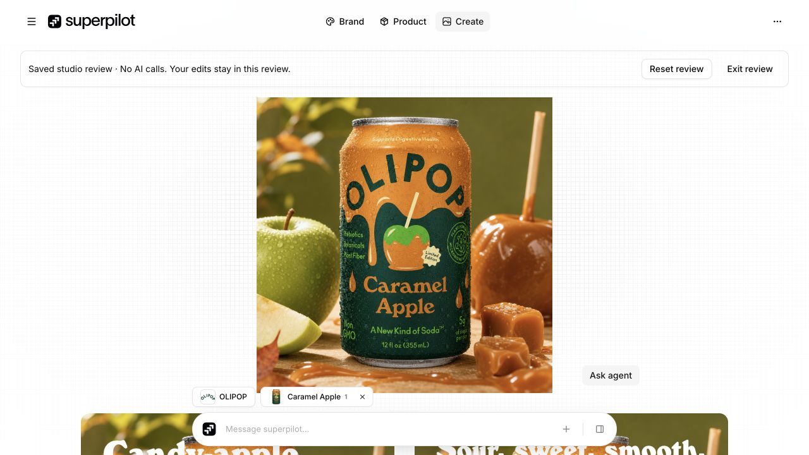

# Catalog/recovery checkpoint — October 26, 2026, 21:50 Pacific

Four distinct 1280×720 views from the same isolated OLIPOP/Caramel Apple/12 Pack review: large saved base, brand review, product grid and selected-product context. A fifth image is supplemental hot-reload evidence, excluded from the distinct count. All originals preserved; exact metadata: [captures.json](captures.json). Base `3ddcc49` plus dirty source; this checkpoint does not reproduce the whole UI.

## Since 21:20

The composing view now emphasizes a large base artwork; DOM exposes three variation controls below the viewport. This saved historical bitmap still contains original lettering. It does not establish text-free generation or completed final composition. The product grid uses compact corner actions/blue selection and the dock includes a Create affordance; review submissions remain disabled. Active source hot reload closed the Visual style modal before its screenshot; the captured artwork view is explicitly labeled supplemental. No reference/context edits, inference or export were performed. Mobile is not part of this comparison.

## Committed source

Completed session 30 catalog scope: `catalog.ts`, `catalog.server.ts`, `catalog-discovery.ts` and its test. Headless storefront fallback follows a single declared myshopify domain, preserves merchant product links, bounds the deadline and reuses the existing public/DNS-pinned transport. Conflicting/arbitrary/lookalike declarations are rejected. Safe user-error mapper and its test return fixed recovery copy rather than provider details and avoid encouraging paid generation retries. These modules are independent of active composing work.

Ten focused offline catalog/discovery/error checks passed; no provider/network call. Source diff/imports reviewed; stable hashes and explicit-index, whitespace, JSON and credential-pattern checks gate commit. Session 30's live Big Star Lights verification is reported by its owner, not repeated here. No build or production verification claimed by this run.

## Deferred

Active composition analysis/generation-result hooks, UI/source integration, shared manifests/dependencies and remaining runtime contracts remain unstaged. Prior description-helper assertion remains a separate deferred failure; it was not rechecked. Generated OpenWiki remains stale for integrated architecture; no refresh is claimed. Recent deployment still contains broader source than Git; this local checkpoint performs no push/deploy. Three-brand outputs and final human composition/fidelity review remain open.

## Images

### 01-composing.png

Large saved base artwork; DOM exposes three variation controls below the viewport. Active composition work; no edits/export. Captured 21:50:50 PDT; 1280×720; OLIPOP / Caramel Apple / 12 Pack; isolated saved-review route; `3ddcc49` + dirty.

### 02-brand.png

Current brand card with compact fonts and context dock; review composer disabled. Captured 21:51:06 PDT; 1280×720; OLIPOP / Caramel Apple / 12 Pack; isolated saved-review route; `3ddcc49` + dirty.

### 03-visual-style.png

Hot reload replaced the visual-style modal before capture: saved artwork view, retained as supplemental reload evidence, excluded from distinct-view count. Captured 21:51:15 PDT; 1280×720; OLIPOP / Caramel Apple / 12 Pack; isolated saved-review route; `3ddcc49` + dirty.

### 04-products.png

Cached grid after shell updates, with current collected-product dock. Captured 21:51:45 PDT; 1280×720; OLIPOP / Caramel Apple / 12 Pack; isolated saved-review route; `3ddcc49` + dirty.

### 05-product-context.png

Selected product image/variant popover; 1 of 8 included, 12 Pack; no edits. Captured 21:51:55 PDT; 1280×720; OLIPOP / Caramel Apple / 12 Pack; isolated saved-review route; `3ddcc49` + dirty.

