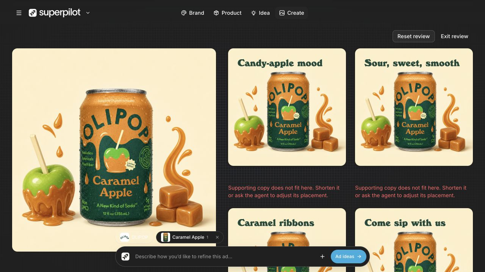
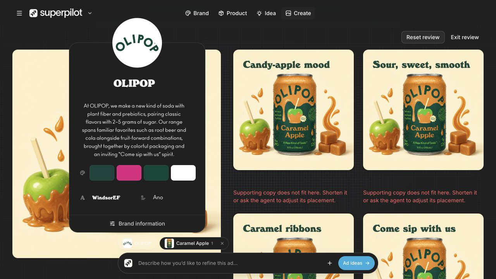
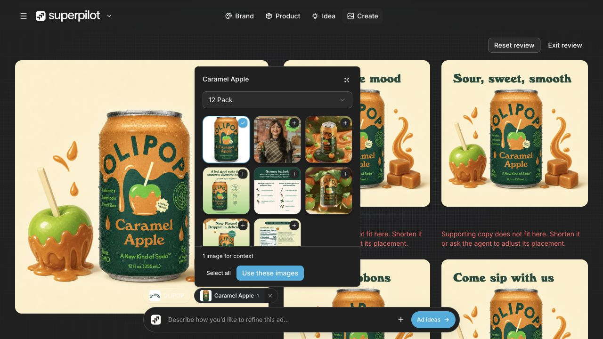
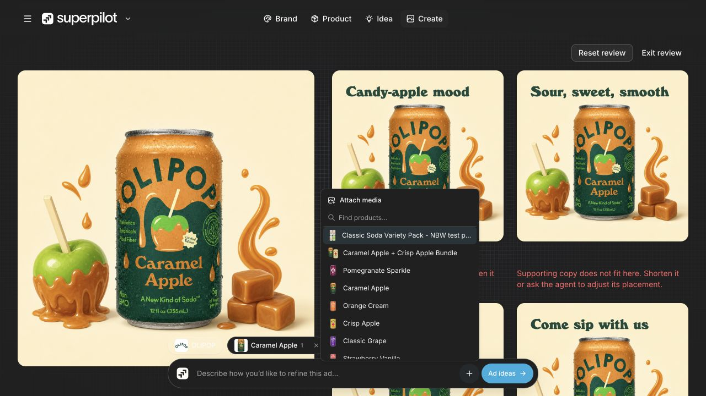

# Planning/recovery checkpoint — October 26, 2026, 23:50 Pacific

Four distinct 1280×720 available states from the same clean-base OLIPOP/Caramel Apple/12 Pack execution: composing, brand context, exact-image product picker and cached composer menu. Metadata: [captures.json](captures.json). Base `a616b9c` plus dirty checkout; not a complete reproducible source release. The saved preference is now dark; this run did not change it. Prior independent Brand/Product navigation had reset to Create, so this archive uses stable local context popovers instead. Idea browsing was not opened because it may prepare paid directions.

## Compared with 23:20

Header now separates Idea and Create. Dark-theme brand/product/menu surfaces and current composer Ad ideas action are archived. The selected reference remains one image. Four headline compositions persist, with the same supporting-copy fit warnings. No action was sent to the agent, no data edited, and no direction/image request or export triggered. Mobile viewport control remains unavailable through the in-app API.

## Committed source/checks

Completed recovery subset: `user-error.ts` and test distinguish a retired/ended session (history retained, new conversation needed) from a retryable connection interruption. `creative-wire.ts` and its test define a required-only provider planning schema and sanitized pre-image failure messages. The richer local validator remains in its owning creative integration; wire schema alone is not proof of complete preparation correctness. Six focused offline checks passed: no UI unions/max-length grammar expansion, safe pre-image errors, catalog/network/persistence safety, paid-retry caution and ended-session behavior. No provider call. Source diffs/imports reviewed; stable hashes, JSON, whitespace, credential scan and explicit-index guards gate commit.

Deferred: active idea carousel/research/cache, full creative/runtime/UI integration, dependencies and source contracts outside this subset. Integrated OpenWiki remains stale; no lifecycle refresh claimed. Prior description-helper failure remains separate; composition body-fit/export/mobile and three-brand deliverables remain open. No push/deploy/external messages. Source uses installed Zod; shared package/lock remains a separate owner-controlled snapshot.

## Captures

### 01-composing.png

Saved compositions with separate Idea/Create navigation; supporting-copy fit warnings remain. Captured 23:51:17 PDT; 1280×720; dark preference already active; same clean-base route and OLIPOP / Caramel Apple / 12 Pack; `a616b9c` + dirty.

### 02-brand-context.png

Cached brand popover in the currently saved dark theme; no preference or context edits. Captured 23:51:28 PDT; 1280×720; dark preference already active; same clean-base route and OLIPOP / Caramel Apple / 12 Pack; `a616b9c` + dirty.

### 03-product-context.png

Current exact-image product picker in dark theme; one reference retained, no submission. Captured 23:51:39 PDT; 1280×720; dark preference already active; same clean-base route and OLIPOP / Caramel Apple / 12 Pack; `a616b9c` + dirty.

### 04-context-menu.png

Composer menu browses cached product context and media action; no option selected or upload. Captured 23:51:53 PDT; 1280×720; dark preference already active; same clean-base route and OLIPOP / Caramel Apple / 12 Pack; `a616b9c` + dirty.

