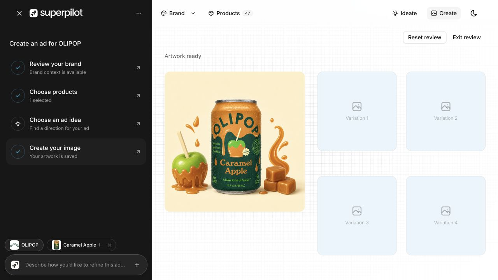
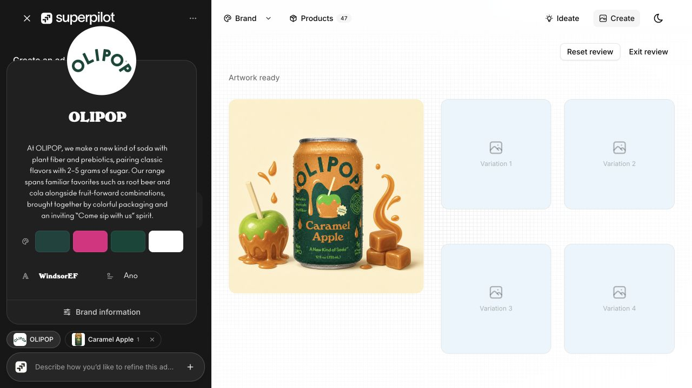
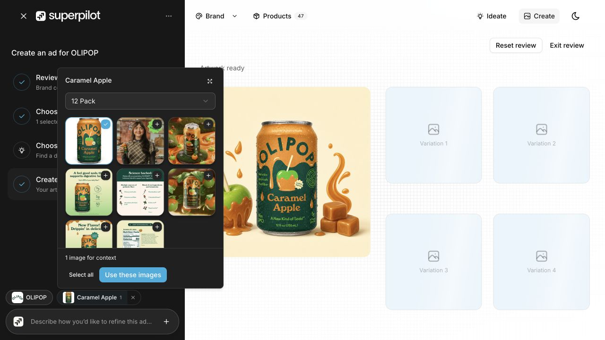
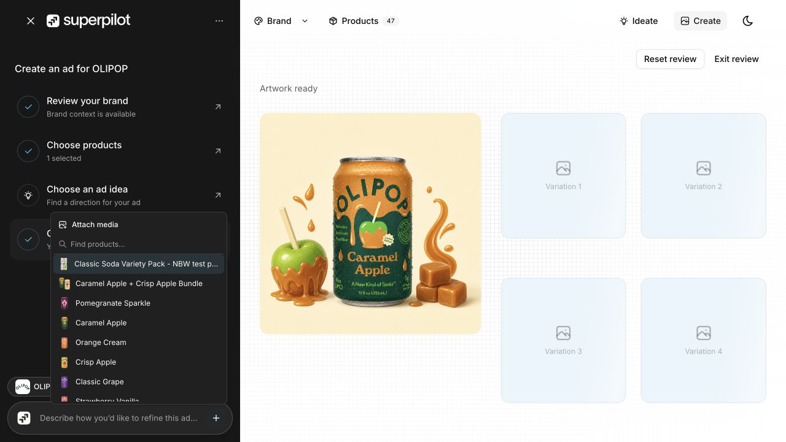

# Readiness/progress checkpoint — October 27, 2026, 00:20 Pacific

Four distinct available states at 1280×720 from the same isolated OLIPOP/Caramel Apple/12 Pack clean-base review: checklist/composing, brand context, product-reference picker and cached composer menu. Metadata: [captures.json](captures.json). Base `7f760ef` plus dirty shared source; partial source commit does not reproduce the whole app. Independent Brand/Product navigation reset during the prior run; current stable popovers avoid that path. Idea preparation was not opened because it may call a model. Mobile capture remains unsupported.

## Compared with 23:50

The unified sidebar now shows an actionable four-step onboarding checklist derived from existing context, selection, ideas and saved artwork. Navigation shows Products with count and Ideate/Create. The main panel is light while sidebar/popovers are dark; no theme preference changed here. Saved base renders; all four variation surfaces appear as preview placeholders in the captured output. DOM still exposes composition controls and supporting-copy fit warnings, so this is not proof of successful visible previews or resolved text fit. No selection/edit/upload/agent/inference/export occurred.

## Source/checks

Completed readiness/progress subset: `idea-readiness.ts` with existing test permits background ideas when source context is usable, avoids endless waits after settled failures, and rejects missing identity. `generation-progress.ts` with existing test derives stage/failure copy from only the current saved job and lets explicit new submission clear stale failure presentation. Four focused offline tests passed. Type-only Studio imports erase at runtime; full Studio contracts remain outside this source subset. Reviewed files, stable hashes, JSON, whitespace, credential-pattern and explicit-index guards gate commit. No full build/provider calls.

Deferred: background idea/network envelope, actual loading integrations, preview rendering, typography fit, uncached extraction, agent/UI/manifests and other owner-held contracts. Source/runtime proof belongs to the owning sessions; their reported strict-type success does not verify this complete dirty UI. Generated OpenWiki remains stale; no refresh claimed. Prior description-helper failure remains deferred. Three-brand output set and final exports/fidelity review remain open. No push, deployment or external message.

## Captures

### 01-checklist-composing.png

Actionable creation checklist, saved base and four variation preview placeholders. DOM still exposes supporting-copy fit warnings. Captured 00:21:06 PDT; 1280×720; same clean-base saved route and OLIPOP / Caramel Apple / 12 Pack; `7f760ef` + dirty.

### 02-brand-context.png

Current brand popover inside the unified sidebar context; original identity retained, no edits. Captured 00:21:19 PDT; 1280×720; same clean-base saved route and OLIPOP / Caramel Apple / 12 Pack; `7f760ef` + dirty.

### 03-product-context.png

Exact-image product picker over current review: 12 Pack, one image for context; no changes. Captured 00:21:31 PDT; 1280×720; same clean-base saved route and OLIPOP / Caramel Apple / 12 Pack; `7f760ef` + dirty.

### 04-context-menu.png

Cached product/media menu in the unified sidebar; no new selection or media upload. Captured 00:21:41 PDT; 1280×720; same clean-base saved route and OLIPOP / Caramel Apple / 12 Pack; `7f760ef` + dirty.

